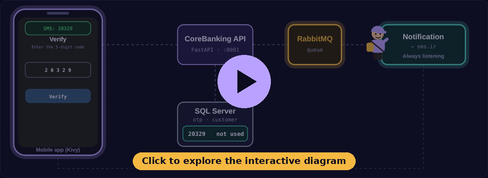

# 📱 BankMobileApp | اپلیکیشن موبایل بانک

A mobile banking app built with Python, Kivy and KivyMD. A customer logs in with a mobile number and a password, confirms a one-time code (OTP) received by SMS, then sees their accounts, balances and transactions. The app talks only to the [CoreBanking](https://github.com/zahrasalimzadeh/CoreBanking) REST API and never touches the database directly. It runs on Windows for development and on Android as an APK.

<div dir="rtl">

‏اپلیکیشن موبایل بانکی که با Python و Kivy و KivyMD ساخته شده است. مشتری با شماره‌ی موبایل و رمز عبور وارد می‌شود، کد یک‌بارمصرف (OTP) را که با پیامک می‌رسد تأیید می‌کند و بعد حساب‌ها، موجودی و تراکنش‌های خودش را می‌بیند. اپلیکیشن فقط با REST API پروژه‌ی [CoreBanking](https://github.com/zahrasalimzadeh/CoreBanking) صحبت می‌کند و هرگز مستقیم به پایگاه داده وصل نمی‌شود. برای توسعه روی ویندوز اجرا می‌شود و برای استفاده روی اندروید به صورت APK ساخته می‌شود.

</div>

---

# 📌 Features | امکانات

- ✅ Login with mobile number and password (checked in the app before it is sent)
- ✅ Two-step login with an OTP sent by SMS
- ✅ List of the accounts of the logged-in customer
- ✅ Balance of each account
- ✅ Transaction list with colored deposit and withdraw rows, newest first
- ✅ Dark theme and the same colors as the CoreBanking desktop application
- ✅ Friendly error messages on every screen (wrong password, wrong code, server not reachable)
- ✅ Logout clears everything the app remembers about the customer
- ✅ Layered structure: Common, DataAccess, BusinessLogic and Presentation
- ✅ Android APK built automatically with GitHub Actions

<div dir="rtl">

- ‏✅ ورود با شماره‌ی موبایل و رمز عبور (قبل از ارسال، داخل خود اپلیکیشن بررسی می‌شود)
- ‏✅ ورود دو مرحله‌ای با کد OTP که با پیامک می‌رسد
- ‏✅ لیست حساب‌های مشتری واردشده
- ‏✅ موجودی هر حساب
- ‏✅ لیست تراکنش‌ها با رنگ‌بندی واریز و برداشت و جدیدترین در بالا
- ‏✅ تم تیره و همان رنگ‌های برنامه‌ی دسکتاپ CoreBanking
- ‏✅ پیام خطای قابل‌فهم در هر صفحه (رمز اشتباه، کد اشتباه، در دسترس نبودن سرور)
- ‏✅ خروج (Logout) همه‌ی چیزهایی را که اپلیکیشن درباره‌ی مشتری به خاطر دارد پاک می‌کند
- ‏✅ ساختار لایه‌بندی‌شده: Common و DataAccess و BusinessLogic و Presentation
- ‏✅ ساخت خودکار APK اندروید با GitHub Actions

</div>

---

# 🎬 Demo video | ویدیوی نمایشی

A short screen recording of the app on a real Android phone: login, the OTP sent by SMS, accounts, balance and transactions.


[](https://zahrasalimzadeh.github.io/BankMobileApp/mobile-flow.html?tab=video)


‏فیلم کوتاهی از اجرای اپلیکیشن روی یک گوشی اندروید واقعی: ورود، کد OTP که با پیامک می‌رسد، حساب‌ها، موجودی و تراکنش‌ها.


---

# 🖼 Screens | صفحه‌ها

### On Android | روی اندروید

| Login | OTP | SMS |
|:-----:|:---:|:---:|
|  |  |  |

| Accounts | Transactions |
|:--------:|:------------:|
|  |  |

<div dir="rtl">

‏تصویرهای بالا به ترتیب: ورود، کد OTP، پیامک دریافتی، حساب‌ها و تراکنش‌ها.

</div>

### On the desktop (development) | روی دسکتاپ (زمان توسعه)

| Login | OTP |
|:-----:|:---:|
|  |  |

| Accounts | Transactions |
|:--------:|:------------:|
|  |  |

| SMS received on the phone |
|:-------------------------:|
|  |

---

# 🔄 How it works | نحوه‌ی کار

Want to see it step by step? Click the image below (it has a Persian / English switch):

<div dir="rtl">

‏می‌خواهید قدم‌به‌قدم ببینید؟ روی تصویر زیر کلیک کنید (دکمه‌ی فارسی / English دارد):

</div>

[](https://zahrasalimzadeh.github.io/BankMobileApp/mobile-flow.html)

1. The customer types a mobile number and a password. The app checks that the mobile number has 11 digits and the password has at least 6 characters.
2. `POST /api/v1/auth/login` is sent. The API checks the password, creates a 5-digit code, stores it in the database and publishes a message to RabbitMQ.
3. The NotificationMicroservice reads the message and sends the code as an SMS through sms.ir.
4. The customer types the code. `POST /api/v1/auth/verify-otp` is sent. The code is valid for 2 minutes and can be used only once.
5. The API returns the customer id and name. The app loads the accounts with `GET /api/v1/accounts?customer_id=`.
6. Tapping an account loads its balance and its transactions.

<div dir="rtl">

1. ‏مشتری شماره‌ی موبایل و رمز عبور را می‌نویسد. اپلیکیشن بررسی می‌کند که موبایل ۱۱ رقم و رمز حداقل ۶ نویسه باشد.
2. ‏درخواست `POST /api/v1/auth/login` فرستاده می‌شود. API رمز را بررسی می‌کند، یک کد ۵ رقمی می‌سازد، آن را در پایگاه داده ذخیره می‌کند و یک پیام در RabbitMQ منتشر می‌کند.
3. ‏میکروسرویس اعلان (NotificationMicroservice) پیام را می‌خواند و کد را با پیامک از طریق sms.ir می‌فرستد.
4. ‏مشتری کد را می‌نویسد و درخواست `POST /api/v1/auth/verify-otp` فرستاده می‌شود. کد ۲ دقیقه اعتبار دارد و فقط یک بار قابل استفاده است.
5. ‏API شماره‌ی مشتری و نام او را برمی‌گرداند. اپلیکیشن حساب‌ها را با `GET /api/v1/accounts?customer_id=` می‌گیرد.
6. ‏با لمس یک حساب، موجودی و تراکنش‌های آن حساب بارگذاری می‌شود.

</div>

---

# 🏗 Architecture | معماری

The project follows the same layers as CoreBanking. Each layer has one job:

<div dir="rtl">

پروژه همان لایه‌های CoreBanking را دارد و هر لایه یک کار دارد:

</div>

| Layer | Job | وظیفه |
|-------|-----|-------|
| `Common` | Constants (server address, colors) and the failure response | ثابت‌ها (آدرس سرور و رنگ‌ها) و پاسخ خطا |
| `DataAccess` | The only place that talks to the server (`ApiClient`) | تنها جایی که با سرور حرف می‌زند |
| `BusinessLogic` | Rules: validation, building requests, remembering the logged-in customer, formatting | قانون‌ها: اعتبارسنجی، ساخت درخواست، به خاطر سپردن مشتری و قالب‌بندی |
| `Presentation` | Screens and widgets | صفحه‌ها و ظاهر برنامه |
| `main.py` | Creates the objects and starts the app | ساخت شیءها و روشن کردن برنامه |

```
BankMobileApp
├── main.py
├── buildozer.spec
├── images/bank.png
├── Common
│   ├── config.py
│   └── response.py
├── DataAccess
│   └── api_client.py
├── BusinessLogic
│   ├── auth_business_logic.py
│   └── account_business_logic.py
├── Presentation
│   ├── components.py
│   └── Screens
│       ├── login_screen.py
│       ├── otp_screen.py
│       ├── accounts_screen.py
│       └── transactions_screen.py
└── .github/workflows/build.yml
```

The server does not answer instantly, so every method of the business logic receives a function (`on_done`) that is called later with the answer.

<div dir="rtl">

‏سرور فوراً جواب نمی‌دهد. به همین دلیل هر تابع لایه‌ی BusinessLogic یک تابع (`on_done`) می‌گیرد که بعداً و با رسیدن جواب صدا زده می‌شود.

</div>

---

# 🌐 API used by the app | APIهای مورد استفاده

| Method | Endpoint | Description | توضیح |
|--------|----------|-------------|-------|
| POST | `/api/v1/auth/login` | Check mobile and password, send the code | بررسی موبایل و رمز و ارسال کد |
| POST | `/api/v1/auth/verify-otp` | Verify the code | بررسی کد |
| GET | `/api/v1/accounts?customer_id=` | Accounts of the customer | حساب‌های مشتری |
| GET | `/api/v1/accounts/{account_id}/balance` | Balance of an account | موجودی یک حساب |
| GET | `/api/v1/transactions?account_id=` | Transactions of an account | تراکنش‌های یک حساب |

The server address is one line in `Common/config.py`:

<div dir="rtl">

‏آدرس سرور فقط یک خط در `Common/config.py` است:

</div>

```python
BASE_URL = "http://192.168.1.9:8001"
```

---

# ▶️ Run on the desktop | اجرا روی دسکتاپ

You need three things running: the CoreBanking API, RabbitMQ and the [NotificationMicroservice](https://github.com/zahrasalimzadeh/NotificationMicroservice).

<div dir="rtl">

‏سه چیز باید روشن باشد: API پروژه‌ی CoreBanking، RabbitMQ و [NotificationMicroservice](https://github.com/zahrasalimzadeh/NotificationMicroservice).

</div>

**1. Start the API** (in the CoreBanking project):

```
uvicorn main_api:app --host 0.0.0.0 --port 8001 --reload
```

**2. Start the NotificationMicroservice** (in its own project): `python main.py`. In the RabbitMQ management page (`http://localhost:15672`, tab **Connections**) you should now see one connection: the service is waiting for messages.


**3. Install and run the app:**

```
pip install kivy==2.3.1 kivymd==1.2.0 pillow
python main.py
```

**4.** Log in with a customer from `CreateDatabase.sql` of CoreBanking (for example password `123456`). The SMS goes to the mobile number stored for that customer, so use a number you own while testing.

<div dir="rtl">

‏۴. با یکی از مشتری‌های فایل `CreateDatabase.sql` پروژه‌ی CoreBanking وارد شوید (مثلاً رمز `123456`). پیامک به شماره‌ی موبایلی که برای آن مشتری ذخیره شده می‌رود، پس هنگام تست از شماره‌ای استفاده کنید که خودتان دارید.

</div>

---

# 📲 Run on an Android phone | اجرا روی گوشی اندروید

The phone and the computer must be on the **same Wi-Fi**.

<div dir="rtl">

‏گوشی و کامپیوتر باید به **یک وای‌فای** وصل باشند.

</div>

1. Find the IPv4 address of the computer: run `ipconfig` and read `IPv4 Address` under the Wi-Fi adapter (for example `192.168.1.9`).
2. Start the API with `--host 0.0.0.0` so that other devices can reach it.
3. Check from another device: open `http://<computer-ip>:8001/health_check` in its browser. It should answer `{"is_health":true}`.


4. Put the address in `Common/config.py` as `BASE_URL`.
5. Download the ready APK from the [Releases page](https://github.com/zahrasalimzadeh/BankMobileApp/releases/latest) (or build it yourself, see the next section), install it and log in.

<div dir="rtl">

1. ‏آدرس IPv4 کامپیوتر را پیدا کنید: دستور `ipconfig` را بزنید و مقدار `IPv4 Address` بخش Wi-Fi را بخوانید (مثلاً `192.168.1.9`).
2. ‏API را با `--host 0.0.0.0` روشن کنید تا دستگاه‌های دیگر هم به آن برسند.
3. ‏از یک دستگاه دیگر بررسی کنید: آدرس `http://<ip-کامپیوتر>:8001/health_check` را در مرورگرش باز کنید. باید `{"is_health":true}` را ببینید (تصویر بالا).
4. ‏آدرس را در `Common/config.py` به عنوان `BASE_URL` بنویسید.
5. ‏فایل APK آماده را از صفحه‌ی [Releases](https://github.com/zahrasalimzadeh/BankMobileApp/releases/latest) بگیرید (یا خودتان بسازید، بخش بعد)، نصب کنید و وارد شوید.

</div>

If the IP address of the computer changes (another Wi-Fi, router restart), change `BASE_URL` and build the APK again.

<div dir="rtl">

‏اگر IP کامپیوتر عوض شود (وای‌فای دیگر یا خاموش و روشن شدن مودم)، `BASE_URL` را عوض کنید و APK را دوباره بسازید.

</div>

---

# 🤖 Build the APK | ساخت APK

A ready-to-install APK is published on the [Releases page](https://github.com/zahrasalimzadeh/BankMobileApp/releases/latest). The APK works only on Android phones.

<div dir="rtl">

‏یک APK آماده‌ی نصب در صفحه‌ی [Releases](https://github.com/zahrasalimzadeh/BankMobileApp/releases/latest) گذاشته شده است. این APK فقط روی گوشی‌های اندروید کار می‌کند.

</div>

The APK is built by GitHub Actions (`.github/workflows/build.yml`) with Buildozer, so no Linux is needed on your computer. Every push starts a build that takes about 18 minutes.

<div dir="rtl">

‏APK با GitHub Actions و ابزار Buildozer ساخته می‌شود، پس به لینوکس روی کامپیوتر خودتان نیازی نیست. با هر Push یک ساخت شروع می‌شود که حدود ۱۸ دقیقه طول می‌کشد.

</div>

1. Open the **Actions** tab of the repository and open the latest green run of **Build APK**.
2. At the bottom, in **Artifacts**, download `bank-apk` (a zip file).
3. Unzip it, send the `.apk` file to the phone and open it. Android asks to allow installing from this source; allow it.

<div dir="rtl">

1. ‏در مخزن به تب **Actions** بروید و آخرین اجرای سبز **Build APK** را باز کنید.
2. ‏پایین صفحه در بخش **Artifacts** فایل `bank-apk` (یک فایل zip) را دانلود کنید.
3. ‏zip را باز کنید، فایل `.apk` را به گوشی بفرستید و باز کنید. اندروید اجازه‌ی نصب از این منبع را می‌پرسد؛ اجازه بدهید.

</div>


Build settings (`buildozer.spec`): Android API 33, minimum API 21, architectures `arm64-v8a` and `armeabi-v7a`, permission `INTERNET`, python-for-android `v2024.01.21`, NDK `25b`.

---

# 🛠 Technologies | فناوری‌ها

| Technology | Use | کاربرد |
|------------|-----|--------|
| Python | Language | زبان برنامه‌نویسی |
| Kivy 2.3 | Cross-platform UI | رابط کاربری چندسکویی |
| KivyMD 1.2.0 | Material Design widgets | ظاهر Material |
| `UrlRequest` (Kivy) | Non-blocking HTTP calls | درخواست‌های HTTP بدون قفل شدن برنامه |
| Buildozer | Creating the Android APK | ساخت APK اندروید |
| GitHub Actions | Building the APK in the cloud | ساخت APK روی سرور GitHub |

---

# ⚠️ Known limitations | محدودیت‌های فعلی

- The app talks to the API over plain HTTP on the local network. A real bank would use HTTPS.
- The server address is fixed inside the app and must be changed (and the APK rebuilt) when it changes.

<div dir="rtl">

- ‏اپلیکیشن با API روی شبکه‌ی محلی و با HTTP ساده صحبت می‌کند. بانک واقعی از HTTPS استفاده می‌کند.
- ‏آدرس سرور داخل اپلیکیشن ثابت است و با تغییرش باید APK دوباره ساخته شود.

</div>

---

# 🔗 Related repositories | مخزن‌های مرتبط

- [CoreBanking](https://github.com/zahrasalimzadeh/CoreBanking): the desktop application and the REST API
- [NotificationMicroservice](https://github.com/zahrasalimzadeh/NotificationMicroservice): reads messages from RabbitMQ and sends SMS through sms.ir

<div dir="rtl">

- ‏[CoreBanking](https://github.com/zahrasalimzadeh/CoreBanking): برنامه‌ی دسکتاپ و REST API
- ‏[NotificationMicroservice](https://github.com/zahrasalimzadeh/NotificationMicroservice): پیام‌ها را از RabbitMQ می‌خواند و با sms.ir پیامک می‌فرستد

</div>
