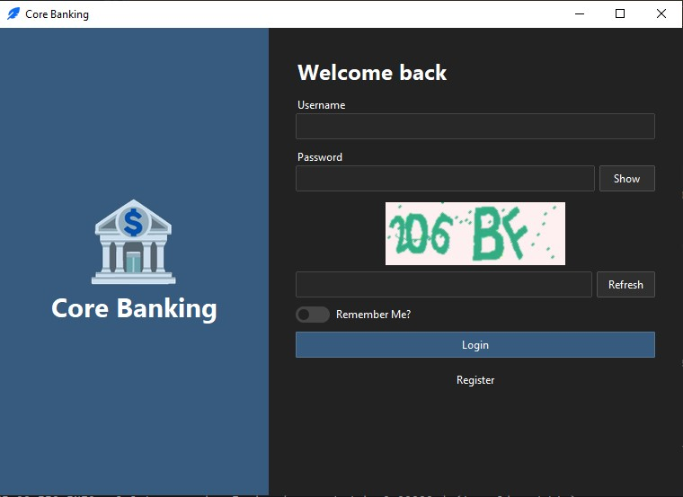
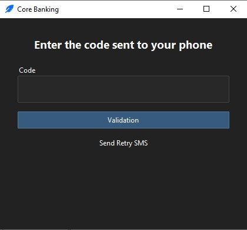
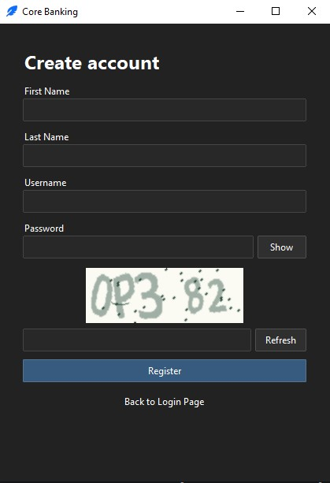
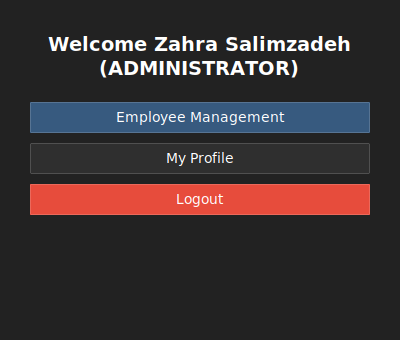
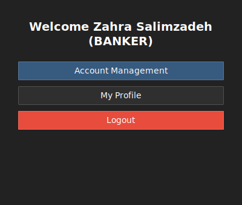

# 🏦 CoreBanking | هسته‌ی بانکداری

A desktop core banking application built with Python, Tkinter and ttkbootstrap. It includes login with captcha, user registration, SMS verification (OTP) delivered through a RabbitMQ microservice, and role-based home pages.
برنامه‌ی دسکتاپ هسته‌ی بانکداری که با Python و Tkinter و ttkbootstrap ساخته شده است. شامل ورود با کپچا، ثبت‌نام کاربر، تأیید پیامکی (OTP) از طریق یک میکروسرویس مبتنی بر RabbitMQ و صفحه‌ی اصلی بر اساس نقش کاربر است.

---

# 📌 Features | امکانات

✅ Login with username, password and captcha  
✅ "Remember Me" option  
✅ User registration with captcha  
✅ SMS verification code (OTP) after login  
✅ Retry button with a 2-minute countdown  
✅ OTP delivery through RabbitMQ and a separate Notification microservice  
✅ Role-based home page (Administrator / Banker)  
✅ Layered architecture (Presentation / Business Logic / Data Access)  
✅ SQL Server database with SQLAlchemy  
✅ Secrets stored in a `.env` file

✅ ورود با نام کاربری، رمز عبور و کپچا  
✅ گزینه‌ی «مرا به خاطر بسپار»  
✅ ثبت‌نام کاربر با کپچا  
✅ کد تأیید پیامکی (OTP) بعد از ورود  
✅ دکمه‌ی ارسال مجدد با شمارش معکوس ۲ دقیقه‌ای  
✅ ارسال OTP از طریق RabbitMQ و یک میکروسرویس جداگانه‌ی Notification  
✅ صفحه‌ی اصلی بر اساس نقش (مدیر / بانکدار)  
✅ معماری لایه‌بندی‌شده (Presentation / Business Logic / Data Access)  
✅ پایگاه داده‌ی SQL Server با SQLAlchemy  
✅ نگهداری رمزها و کلیدها در فایل `.env`

### 🚧 In Progress | در حال توسعه

- Employee Management (Administrator)
- Account Management (Banker)
- My Profile editing

- مدیریت کارمندان (مدیر)
- مدیریت حساب‌ها (بانکدار)
- ویرایش پروفایل من

---

# 🏗 Architecture | معماری

CoreBanking does not call the SMS provider directly. It publishes the verification code to RabbitMQ, and the Notification microservice consumes it and sends the SMS through sms.ir.
CoreBanking مستقیم به سرویس پیامک وصل نمی‌شود. کد تأیید را در RabbitMQ منتشر می‌کند و میکروسرویس Notification آن را برمی‌دارد و از طریق sms.ir پیامک می‌فرستد.


[Open the interactive diagram | باز کردن نمودار تعاملی](https://zahrasalimzadeh.github.io/NotificationMicroservice/diagram.html)

1. After a successful login, CoreBanking generates a verification code.
2. It publishes the message (`phone`, `content`) to RabbitMQ through `NotificationPublisher`.
3. [NotificationMicroservice](https://github.com/zahrasalimzadeh/NotificationMicroservice) consumes the message and sends the SMS to sms.ir.
4. The user enters the code, and CoreBanking validates it and opens the home page.

۱. بعد از ورود موفق، CoreBanking یک کد تأیید می‌سازد.  
۲. پیام (`phone` و `content`) را با `NotificationPublisher` در RabbitMQ منتشر می‌کند.  
۳. [NotificationMicroservice](https://github.com/zahrasalimzadeh/NotificationMicroservice) پیام را برمی‌دارد و پیامک را به sms.ir می‌فرستد.  
۴. کاربر کد را وارد می‌کند و CoreBanking آن را بررسی می‌کند و صفحه‌ی اصلی را باز می‌کند.

---

# 🛠 Technologies Used | تکنولوژی‌های استفاده‌شده

- Python
- Tkinter
- ttkbootstrap
- SQLAlchemy
- SQL Server (pyodbc, pymssql)
- RabbitMQ (pika)
- python-dotenv
- Captcha (Pillow)
- Layered Architecture
- Microservice Architecture

---

# 📂 Project Structure | ساختار پروژه

```
CoreBanking/
│
├── BusinessLogic/
│   └── user_business_logic.py
│
├── Common/
│   ├── DTOs/
│   ├── Entities/
│   ├── Enums/
│   ├── Repositories/
│   └── Services/
│       ├── notification_publisher.py
│       └── sms_service.py
│
├── DataAccess/
│   ├── Config/
│   ├── Models/
│   └── Repositories/
│
├── Presentation/
│   ├── Component/
│   ├── Frames/
│   │   ├── login.py
│   │   ├── register.py
│   │   ├── otp.py
│   │   ├── home.py
│   │   └── profile.py
│   ├── main_view.py
│   └── window.py
│
├── .env.example
├── .gitignore
├── CreateDatabase.sql
├── main.py
└── requirements.txt
```

| Layer / لایه    | Responsibility                                  | وظیفه                                          |
| --------------- | ----------------------------------------------- | ---------------------------------------------- |
| `Presentation`  | Tkinter windows and frames                      | پنجره‌ها و صفحه‌های Tkinter                    |
| `BusinessLogic` | Login, registration and validation rules        | قوانین ورود، ثبت‌نام و اعتبارسنجی              |
| `DataAccess`    | SQLAlchemy models and repositories              | مدل‌ها و ریپازیتوری‌های SQLAlchemy             |
| `Common`        | Entities, enums, DTOs and shared services       | موجودیت‌ها، Enum ها، DTO ها و سرویس‌های مشترک  |

---

# 🔐 Roles | نقش‌ها

| Role          | Home page options                         | گزینه‌های صفحه‌ی اصلی                    |
| ------------- | ----------------------------------------- | ---------------------------------------- |
| Administrator | Employee Management, My Profile, Logout   | مدیریت کارمندان، پروفایل من، خروج        |
| Banker        | Account Management, My Profile, Logout    | مدیریت حساب‌ها، پروفایل من، خروج         |

---

# ⚙️ Environment Variables | متغیرهای محیطی

Copy `.env.example` to `.env` and fill in the values. The `.env` file is ignored by Git and must never be uploaded.
فایل `.env.example` را به `.env` کپی کنید و مقدارها را پر کنید. فایل `.env` توسط Git نادیده گرفته می‌شود و هرگز نباید آپلود شود.

| Variable                | Description                                          | توضیح                                              |
| ----------------------- | ---------------------------------------------------- | -------------------------------------------------- |
| `DB_SERVER`             | SQL Server address                                   | آدرس SQL Server                                    |
| `DB_NAME`               | Database name                                        | نام پایگاه داده                                    |
| `DB_USERNAME`           | Database username                                    | نام کاربری پایگاه داده                             |
| `DB_PASSWORD`           | Database password                                    | رمز عبور پایگاه داده                               |
| `DB_DRIVER`             | ODBC driver used by pyodbc, installed on your machine | نام ODBC Driver نصب‌شده روی سیستم که pyodbc استفاده می‌کند |
| `RABBITMQ_HOST`         | RabbitMQ server address                              | آدرس سرور RabbitMQ                                 |
| `RABBITMQ_PORT`         | RabbitMQ port (5672)                                 | پورت RabbitMQ (معمولاً 5672)                       |
| `RABBITMQ_USERNAME`     | RabbitMQ username                                    | نام کاربری RabbitMQ                                |
| `RABBITMQ_PASSWORD`     | RabbitMQ password                                    | رمز عبور RabbitMQ                                  |
| `RABBITMQ_VIRTUAL_HOST` | RabbitMQ virtual host                                | Virtual Host در RabbitMQ                           |
| `SMSIR_API_KEY`         | sms.ir API key                                       | کلید API سایت sms.ir                               |
| `SMSIR_LINE_NUMBER`     | sms.ir line number                                   | شماره‌ی خط sms.ir                                  |

---

# 🚀 How To Run | نحوه اجرا

Make sure SQL Server and RabbitMQ are installed and running, then clone the repository:
مطمئن شوید SQL Server و RabbitMQ نصب و روشن هستند، سپس پروژه را کلون کنید:

```
git clone https://github.com/zahrasalimzadeh/CoreBanking.git
```

Open the project folder:

```
cd CoreBanking
```

Install the requirements:

```
pip install -r requirements.txt
```

Create the database by running `CreateDatabase.sql` in SQL Server Management Studio.
پایگاه داده را با اجرای فایل `CreateDatabase.sql` در SQL Server Management Studio بسازید.

Create your `.env` file from the example and fill in the values:

```
copy .env.example .env
```

Start the [NotificationMicroservice](https://github.com/zahrasalimzadeh/NotificationMicroservice) (it must be running to deliver the SMS), then run the application:
میکروسرویس [NotificationMicroservice](https://github.com/zahrasalimzadeh/NotificationMicroservice) را اجرا کنید (برای ارسال پیامک باید روشن باشد)، سپس برنامه را اجرا کنید:

```
python main.py
```

---

# 🎥 Demo | دمو

### 📸 Screenshots | تصاویر

**1. Login page with captcha | صفحه‌ی ورود با کپچا**



**2. Verification code page | صفحه‌ی وارد کردن کد تأیید**



**3. Registration page | صفحه‌ی ثبت‌نام**



**4. Administrator home page | صفحه‌ی اصلی مدیر**



**5. Banker home page | صفحه‌ی اصلی بانکدار**



### 🎬 Videos | ویدیوها

The demo videos are published on LinkedIn:
ویدیوهای دمو در LinkedIn منتشر شده‌اند:

| Video                                        | ویدیو                                         | Link |
| -------------------------------------------- | --------------------------------------------- | ---- |
| Architecture diagram                         | نمودار معماری                                 | [Watch on LinkedIn](https://www.linkedin.com/in/zahra-salimzadeh-5767582ab/) |
| Login and waiting for the verification code  | ورود و منتظر ماندن برای کد تأیید              | [Watch on LinkedIn](https://www.linkedin.com/in/zahra-salimzadeh-5767582ab/) |
| Receiving the code                           | دریافت کد                                     | [Watch on LinkedIn](https://www.linkedin.com/in/zahra-salimzadeh-5767582ab/) |
| Home page after verification                 | صفحه‌ی اصلی بعد از تأیید                      | [Watch on LinkedIn](https://www.linkedin.com/in/zahra-salimzadeh-5767582ab/) |

---

# 📝 Notes | نکات

- The verification SMS is delivered by the NotificationMicroservice through sms.ir. An sms.ir account with enough credit is required to receive the real SMS.
- The queue and exchange names must be the same in CoreBanking and in the NotificationMicroservice.

- پیامک تأیید توسط NotificationMicroservice و از طریق sms.ir ارسال می‌شود. برای دریافت پیامک واقعی، حساب sms.ir باید اعتبار کافی داشته باشد.
- نام Exchange و Queue باید در CoreBanking و NotificationMicroservice یکسان باشد.

---

# 👩‍💻 Developer | توسعه‌دهنده

**Zahra Salimzadeh**

- LinkedIn: <https://www.linkedin.com/in/zahra-salimzadeh-5767582ab/>
- Email: <zahrasalimzadeh7@gmail.com>
