# 🏦 CoreBanking | هسته‌ی بانکداری

A core banking application built with Python. It has a desktop application (Tkinter and ttkbootstrap) and a REST API (FastAPI) that serves a mobile banking app. It includes login with captcha, SMS verification (OTP) delivered through a RabbitMQ microservice, an API for balance, transactions and accounts, unit tests, and performance monitoring (database logging, Prometheus metrics and a Grafana dashboard).

<div dir="rtl">

‏هسته‌ی بانکداری که با Python ساخته شده است. شامل یک برنامه‌ی دسکتاپ (Tkinter و ttkbootstrap) و یک REST API (با FastAPI) برای اپلیکیشن موبایل بانکی است. امکاناتی مثل ورود با کپچا، تأیید پیامکی (OTP) از طریق یک میکروسرویس مبتنی بر RabbitMQ، API موجودی، تراکنش‌ها و حساب‌ها، تست واحد و پایش عملکرد (ذخیره‌ی لاگ در دیتابیس، متریک‌های Prometheus و داشبورد Grafana) دارد.

</div>

---

# 📌 Features | امکانات

### Desktop application | برنامه‌ی دسکتاپ

- ✅ Login with username, password and captcha
- ✅ "Remember Me" option
- ✅ User registration with captcha
- ✅ SMS verification code (OTP) after login
- ✅ Retry button with a 2-minute countdown
- ✅ Role-based home page (Administrator / Banker)

<div dir="rtl">

- ‏✅ ورود با نام کاربری، رمز عبور و کپچا
- ‏✅ گزینه‌ی «مرا به خاطر بسپار»
- ‏✅ ثبت‌نام کاربر با کپچا
- ‏✅ کد تأیید پیامکی (OTP) بعد از ورود
- ‏✅ دکمه‌ی ارسال مجدد با شمارش معکوس ۲ دقیقه‌ای
- ‏✅ صفحه‌ی اصلی بر اساس نقش (مدیر / بانکدار)

</div>

### REST API for the mobile app | API برای اپلیکیشن موبایل

- ✅ Customer login with mobile number and password
- ✅ Two-step login: the API stores a one-time code (OTP) in the database, publishes a message to RabbitMQ and answers immediately
- ✅ OTP verification (valid for 2 minutes, usable only once)
- ✅ Accounts of a customer, account balance and transaction list
- ✅ Interactive documentation with Swagger (`/docs`)
- ✅ Unit tests for the business logic (28 tests)

<div dir="rtl">

- ‏✅ ورود مشتری با شماره‌ی موبایل و رمز عبور
- ‏✅ ورود دو مرحله‌ای: API کد یک‌بارمصرف (OTP) را در دیتابیس ذخیره می‌کند، پیام را در RabbitMQ منتشر می‌کند و فوراً جواب می‌دهد
- ‏✅ بررسی OTP (۲ دقیقه اعتبار دارد و فقط یک بار قابل استفاده است)
- ‏✅ حساب‌های مشتری، موجودی حساب و لیست تراکنش‌ها
- ‏✅ مستندات تعاملی با Swagger (آدرس `/docs`)
- ‏✅ تست واحد برای لایه‌ی منطق برنامه (۲۸ تست)

</div>

### Shared | مشترک

- ✅ Layered architecture (Presentation / Business Logic / Data Access)
- ✅ SQL Server database with SQLAlchemy
- ✅ Secrets stored in a `.env` file
- ✅ OTP delivery through RabbitMQ and a separate Notification microservice
- ✅ Function execution logs saved in the database
- ✅ Execution metrics exposed to Prometheus
- ✅ Metrics displayed in a Grafana dashboard

<div dir="rtl">

- ‏✅ معماری لایه‌بندی‌شده (Presentation / Business Logic / Data Access)
- ‏✅ پایگاه داده‌ی SQL Server با SQLAlchemy
- ‏✅ نگهداری رمزها و کلیدها در فایل `.env`
- ‏✅ ارسال OTP از طریق RabbitMQ و یک میکروسرویس جداگانه‌ی Notification
- ‏✅ ذخیره‌ی لاگ اجرای توابع در پایگاه داده
- ‏✅ ارسال اطلاعات اجرا به Prometheus
- ‏✅ نمایش اطلاعات در داشبورد Grafana

</div>

### 🚧 In Progress | در حال توسعه

- Mobile banking app (Kivy), in a separate repository
- Employee Management (Administrator)
- Account Management (Banker)
- My Profile editing

<div dir="rtl">

- ‏اپلیکیشن موبایل بانکی (Kivy) در یک ریپازیتوری جداگانه
- ‏مدیریت کارمندان (مدیر)
- ‏مدیریت حساب‌ها (بانکدار)
- ‏ویرایش پروفایل من

</div>

---

# 🏗 Architecture | معماری

CoreBanking does not call the SMS provider directly. It publishes the verification code to RabbitMQ, and the Notification microservice consumes it and sends the SMS through sms.ir.

<div dir="rtl">

‏CoreBanking مستقیم به سرویس پیامک وصل نمی‌شود. کد تأیید را در RabbitMQ منتشر می‌کند و میکروسرویس Notification آن را برمی‌دارد و از طریق sms.ir پیامک می‌فرستد.

</div>

[](https://raw.githubusercontent.com/zahrasalimzadeh/NotificationMicroservice/main/diagram.jpg)

[Open the interactive diagram | باز کردن نمودار تعاملی](https://zahrasalimzadeh.github.io/NotificationMicroservice/diagram.html)

## Desktop login flow | جریان ورود در برنامه‌ی دسکتاپ

1. After a successful login, CoreBanking generates a verification code.
2. It publishes the message (`phone`, `content`) to RabbitMQ through `NotificationPublisher`.
3. [NotificationMicroservice](https://github.com/zahrasalimzadeh/NotificationMicroservice) consumes the message and sends the SMS to sms.ir.
4. The user enters the code, and CoreBanking validates it and opens the home page.

<div dir="rtl">

1. ‏بعد از ورود موفق، CoreBanking یک کد تأیید می‌سازد.
2. ‏پیام (`phone` و `content`) را با `NotificationPublisher` در RabbitMQ منتشر می‌کند.
3. ‏[NotificationMicroservice](https://github.com/zahrasalimzadeh/NotificationMicroservice) پیام را برمی‌دارد و پیامک را به sms.ir می‌فرستد.
4. ‏کاربر کد را وارد می‌کند و CoreBanking آن را بررسی می‌کند و صفحه‌ی اصلی را باز می‌کند.

</div>

## Mobile login flow | جریان ورود در اپلیکیشن موبایل

The mobile app only calls the API and manages the user interface. The API does not wait for the SMS: it stores the code, publishes the message and answers immediately.

<div dir="rtl">

‏اپلیکیشن موبایل فقط API را صدا می‌زند و رابط کاربری را مدیریت می‌کند. API منتظر ارسال پیامک نمی‌ماند: کد را ذخیره می‌کند، پیام را منتشر می‌کند و بلافاصله پاسخ می‌دهد.

</div>

[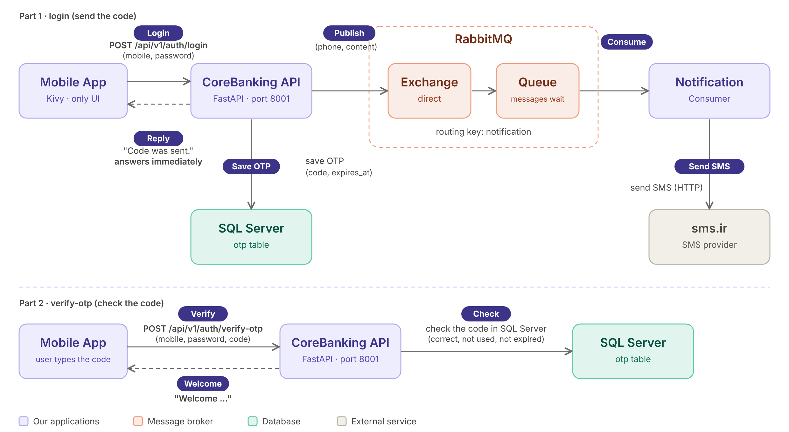](docs/images/mobile-login-flow.png)

---

# 🌐 REST API | واسط برنامه‌نویسی

The API is built with FastAPI and listens on port **8001** (port 8000 is used by the Prometheus metrics of the desktop application). Start it with:

<div dir="rtl">

‏API با FastAPI ساخته شده و روی پورت **8001** اجرا می‌شود (پورت 8000 برای متریک‌های Prometheus برنامه‌ی دسکتاپ استفاده می‌شود). برای اجرا:

</div>

```
uvicorn main_api:app --port 8001 --reload
```

Then open the interactive documentation at `http://127.0.0.1:8001/docs`.

<div dir="rtl">

‏سپس مستندات تعاملی را در آدرس `http://127.0.0.1:8001/docs` باز کنید.

</div>

[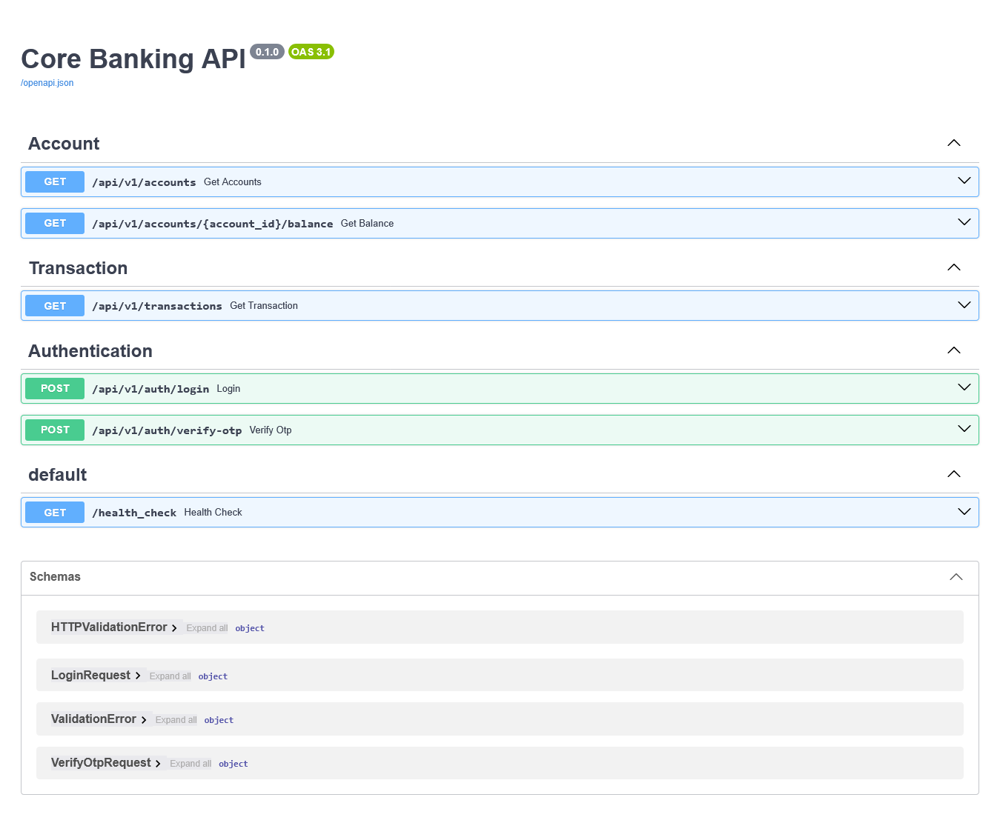](docs/images/swagger-overview.png)

| Method | Endpoint                                | Description                                   | توضیح                                          |
|--------|-----------------------------------------|-----------------------------------------------|------------------------------------------------|
| POST   | `/api/v1/auth/login`                    | Check mobile and password, create and send OTP | بررسی موبایل و رمز، ساخت و ارسال OTP          |
| POST   | `/api/v1/auth/verify-otp`               | Verify the OTP and finish the login           | بررسی OTP و تکمیل ورود                         |
| GET    | `/api/v1/accounts?customer_id=`         | Accounts of a customer                        | حساب‌های یک مشتری                              |
| GET    | `/api/v1/accounts/{account_id}/balance` | Balance of an account                         | موجودی یک حساب                                 |
| GET    | `/api/v1/transactions?account_id=`      | Transactions of an account (newest first)     | تراکنش‌های یک حساب (جدیدترین اول)              |
| GET    | `/health_check`                         | Check that the API is running                 | بررسی روشن بودن API                            |

Every endpoint (except `health_check`) returns the same response shape:

<div dir="rtl">

‏همه‌ی endpoint ها (به‌جز `health_check`) پاسخ را با همین قالب برمی‌گردانند:

</div>

```json
{
  "success": true,
  "message": "Balance was loaded.",
  "data": 5500000
}
```

The balance is calculated as the sum of deposits minus the sum of withdrawals of the account.

<div dir="rtl">

‏موجودی حساب برابر است با جمع واریزها منهای جمع برداشت‌های آن حساب.

</div>

## Login (step 1) | ورود (مرحله‌ی ۱)

Request body: `{"mobile": "09120000002", "password": "123456"}` (sample customer from `CreateDatabase.sql`).

<div dir="rtl">

‏بدنه‌ی درخواست: `{"mobile": "09120000002", "password": "123456"}` (مشتری نمونه از فایل `CreateDatabase.sql`).

</div>

[](docs/images/api-login.png)

The code is saved in the `otp` table (valid for 2 minutes):

<div dir="rtl">

‏کد در جدول `otp` ذخیره می‌شود (۲ دقیقه اعتبار دارد):

</div>

[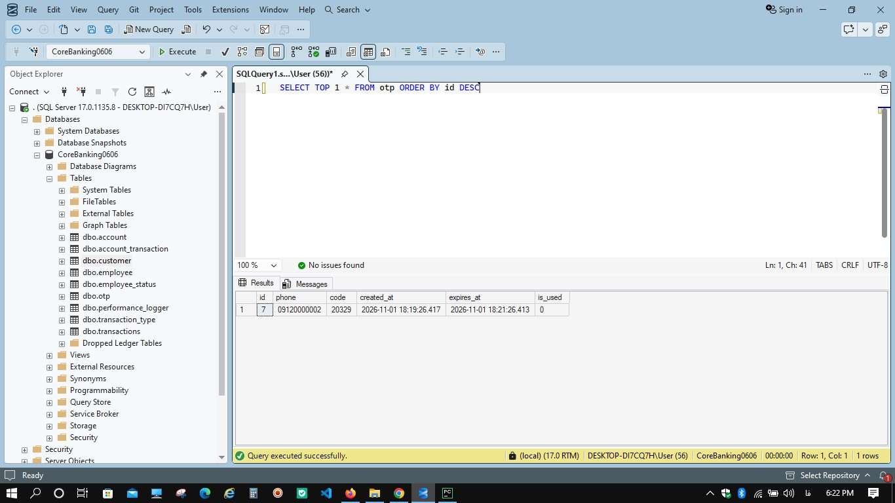](docs/images/db-otp-table.jpg)

## Verify OTP (step 2) | تأیید OTP (مرحله‌ی ۲)

Request body: `{"mobile": "09120000002", "password": "123456", "code": "20329"}`

<div dir="rtl">

‏بدنه‌ی درخواست: `{"mobile": "09120000002", "password": "123456", "code": "20329"}`

</div>

[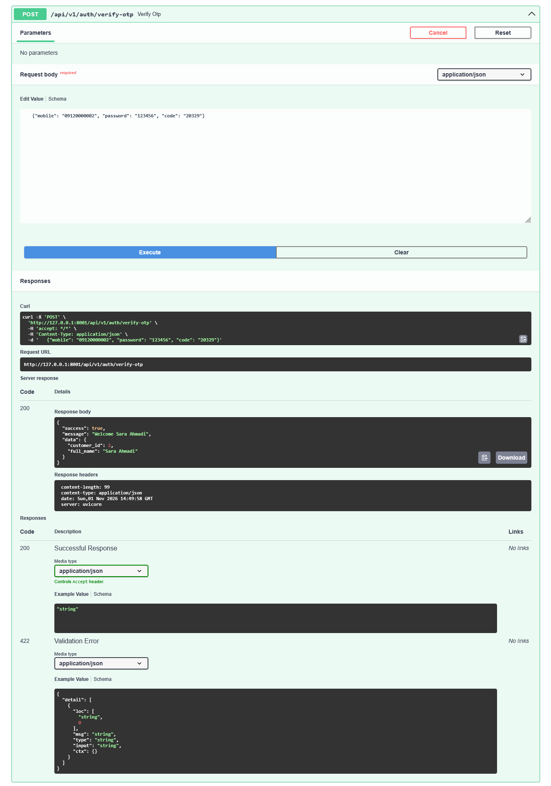](docs/images/api-verify-otp.png)

A code can be used only once. Sending the same code again is rejected:

<div dir="rtl">

‏هر کد فقط یک بار قابل استفاده است. ارسال دوباره‌ی همان کد رد می‌شود:

</div>

[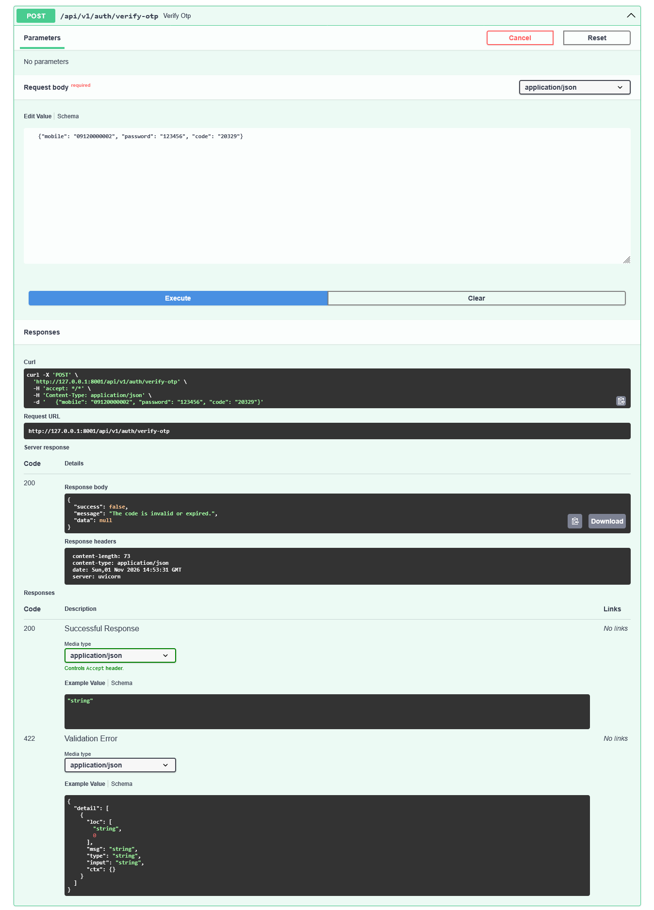](docs/images/api-verify-otp-used.png)

## Accounts, balance and transactions | حساب‌ها، موجودی و تراکنش‌ها

[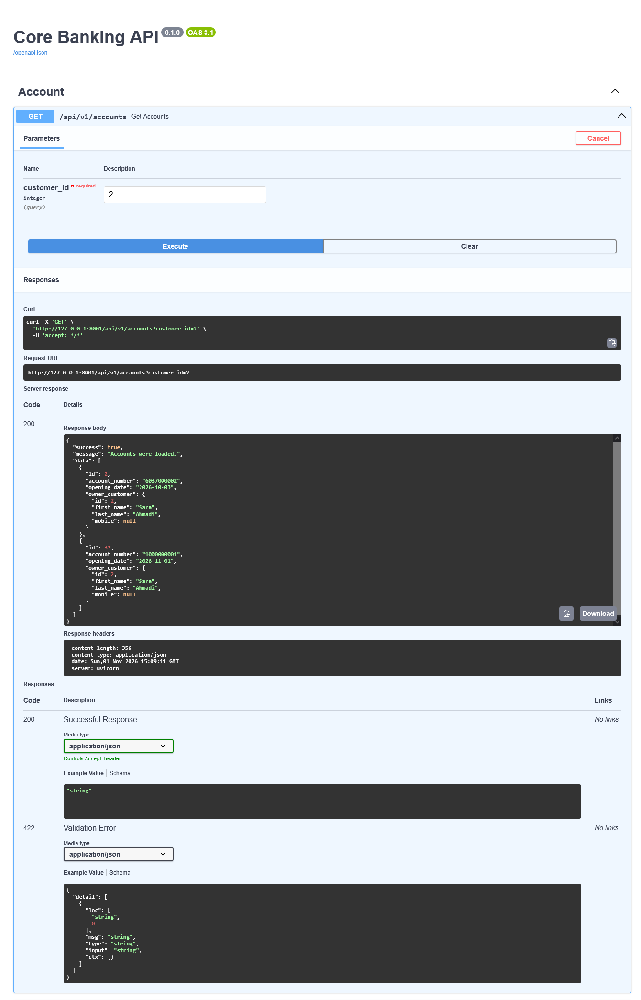](docs/images/api-accounts.png)

[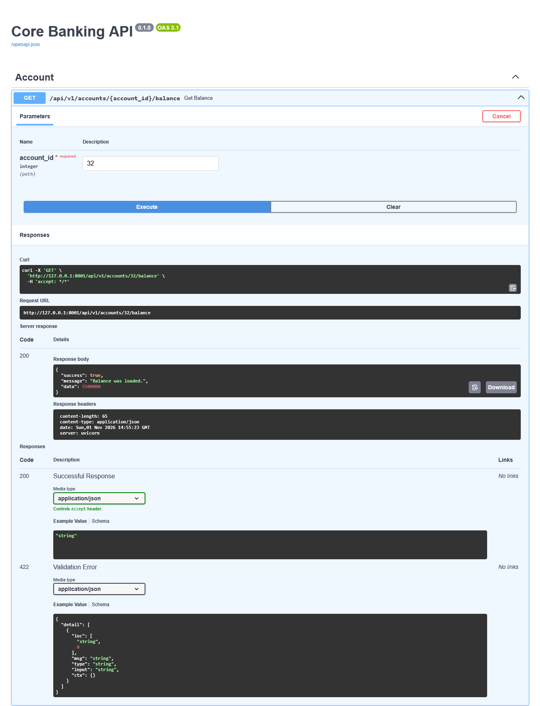](docs/images/api-balance.png)

[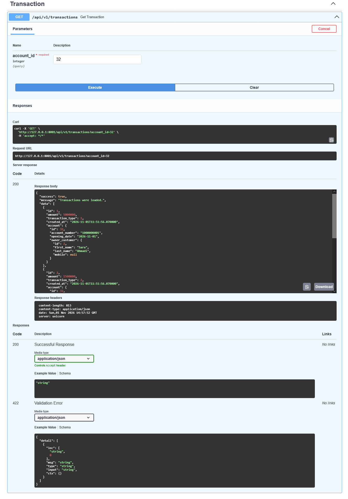](docs/images/api-transactions.png)

---

# 🗄 Database | پایگاه داده

SQL Server with SQLAlchemy. `CreateDatabase.sql` creates the database, all tables and some sample data (30 customers, 32 accounts and 4 sample transactions).

<div dir="rtl">

‏SQL Server با SQLAlchemy. فایل `CreateDatabase.sql` پایگاه داده، همه‌ی جدول‌ها و مقداری داده‌ی نمونه (۳۰ مشتری، ۳۲ حساب و ۴ تراکنش نمونه) را می‌سازد.

</div>

| Table                | Description                                                   | توضیح                                              |
|----------------------|---------------------------------------------------------------|----------------------------------------------------|
| `employee`           | Desktop users (username, hashed password, mobile, role)       | کاربران برنامه‌ی دسکتاپ                            |
| `employee_status`    | Pending / Active / Deactive                                   | وضعیت کارمند                                       |
| `customer`           | Bank customers (name, mobile, hashed password)                | مشتری‌های بانک (نام، موبایل، رمز هش‌شده)           |
| `account`            | Accounts of customers (unique account number, opening date)   | حساب‌های مشتری‌ها (شماره‌ی حساب یکتا، تاریخ افتتاح) |
| `transaction_type`   | Deposit / Withdraw                                            | نوع تراکنش (واریز / برداشت)                        |
| `transactions`       | Deposits and withdrawals of accounts                          | واریزها و برداشت‌های حساب‌ها                       |
| `otp`                | One-time codes (phone, code, expiry time, used flag)          | کدهای یک‌بارمصرف (موبایل، کد، زمان انقضا، استفاده‌شده) |
| `performance_logger` | Function execution log                                        | لاگ اجرای توابع                                    |

All sample customers have the password `123456` (stored as an MD5 hash). The sample data is only for development.

<div dir="rtl">

‏رمز همه‌ی مشتری‌های نمونه `123456` است (به‌صورت هش MD5 ذخیره شده). داده‌ی نمونه فقط برای توسعه است.

</div>

---

# 🧪 Unit Tests | تست واحد

The business logic (login, OTP and account rules) is tested with the standard `unittest` module. The tests use fake repositories, so they do not need SQL Server or RabbitMQ and finish in a few milliseconds.

<div dir="rtl">

‏منطق برنامه (ورود، OTP و قوانین حساب) با ماژول استاندارد `unittest` تست شده است. تست‌ها از repository های ساختگی استفاده می‌کنند، پس به SQL Server و RabbitMQ نیاز ندارند و در چند میلی‌ثانیه تمام می‌شوند.

</div>

```
python -m unittest discover -s tests -t . -v
```

| Test file                         | Tests | What it checks                                                                 |
|-----------------------------------|-------|--------------------------------------------------------------------------------|
| `test_otp_business_logic.py`      | 9     | Sending a code, wrong / expired / already used code, RabbitMQ is down          |
| `test_auth_business_logic.py`     | 11    | Valid login, invalid mobile, short password, wrong password, wrong code        |
| `test_account_business_logic.py`  | 8     | Balance, transactions and accounts with valid and invalid ids                  |

[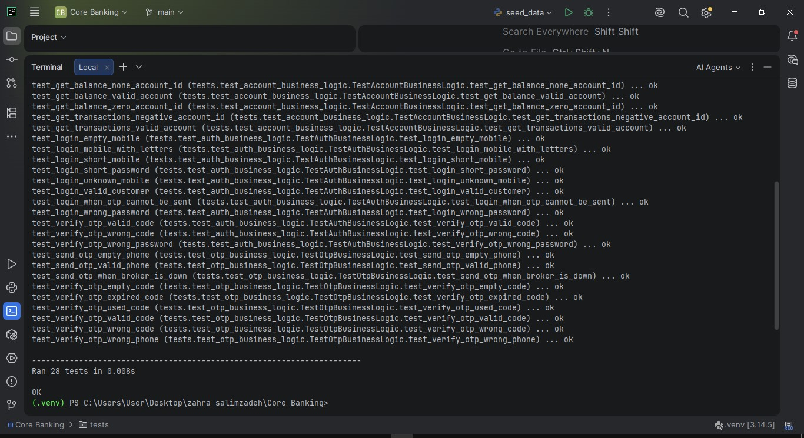](docs/images/unit-tests.jpg)

---

# 📈 Monitoring | پایش عملکرد

Every function decorated with `@performance_logger` is measured on each call. The result goes to two places: a SQL Server table (the log) and Prometheus (the metrics). Grafana reads the metrics from Prometheus and shows them in a dashboard.

<div dir="rtl">

‏هر تابعی که با `@performance_logger` علامت‌گذاری شده باشد در هر بار اجرا اندازه‌گیری می‌شود. نتیجه در دو جا ثبت می‌شود: یک جدول در SQL Server (لاگ) و Prometheus (متریک‌ها). Grafana متریک‌ها را از Prometheus می‌خواند و در یک داشبورد نشان می‌دهد.

</div>

[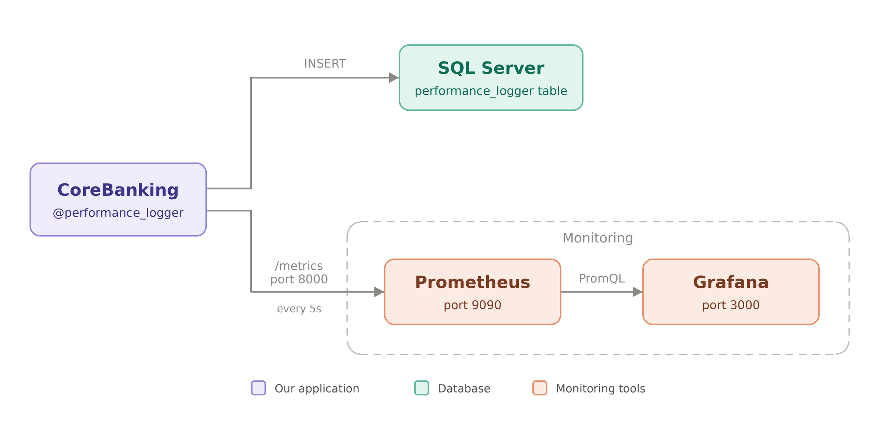](docs/images/monitoring-diagram.png)

## 1. Database log | لاگ در پایگاه داده

The decorator lives in `Common/Decorators/performance_logger.py` and the table model in `DataAccess/Models/performance_logger.py`. The table is created automatically on the first run (`Base.metadata.create_all`).

<div dir="rtl">

‏دکوراتور در `Common/Decorators/performance_logger.py` و مدل جدول در `DataAccess/Models/performance_logger.py` قرار دارد. جدول در اولین اجرا به‌صورت خودکار ساخته می‌شود.

</div>

| Column / ستون    | Type / نوع       | Description / توضیح                |
|------------------|------------------|------------------------------------|
| `id`             | int (PK)         | Auto-increment key / کلید خودکار   |
| `function_name`  | nvarchar(100)    | Name of the function / نام تابع    |
| `execution_time` | numeric(18, 10)  | Execution time in seconds / زمان اجرا به ثانیه |
| `call_date_time` | datetime         | When it was called / زمان فراخوانی |

Example functions that are measured: `login_button_clicked` and `get_by_username_password`.

<div dir="rtl">

‏نمونه توابعی که اندازه‌گیری می‌شوند: `login_button_clicked` و `get_by_username_password`.

</div>

Logs saved in the `performance_logger` table:

<div dir="rtl">

‏لاگ‌های ذخیره‌شده در جدول `performance_logger`:

</div>

[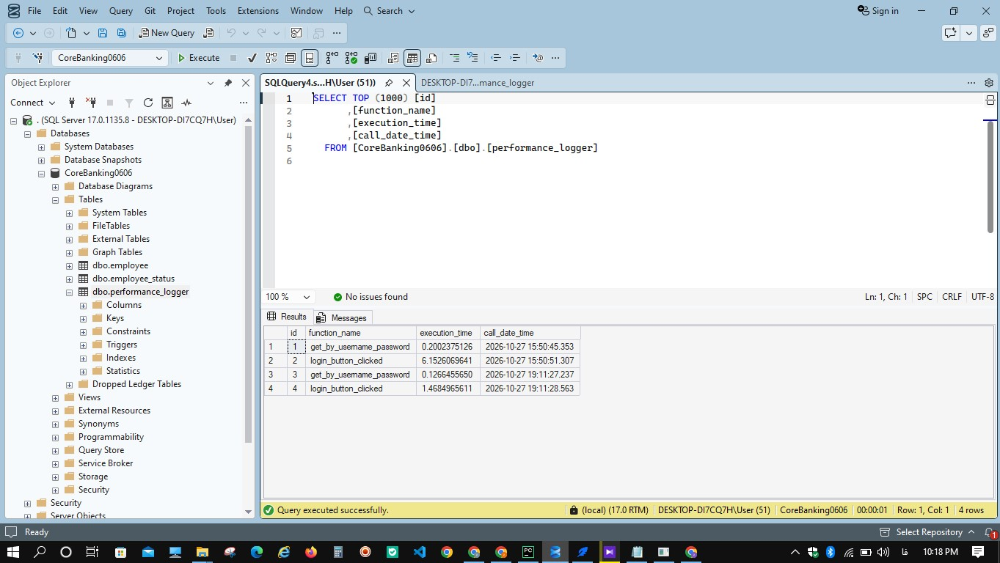](docs/images/db-performance-logger.jpg)

## 2. Prometheus metrics | متریک‌های Prometheus

`main.py` starts a metrics server with `start_http_server(8000)`. While the application is running, the metrics are available at `http://127.0.0.1:8000/metrics`.

<div dir="rtl">

‏فایل `main.py` یک سرور متریک با `start_http_server(8000)` راه‌اندازی می‌کند. تا وقتی برنامه روشن است، متریک‌ها در آدرس `http://127.0.0.1:8000/metrics` در دسترس هستند.

</div>

| Metric / متریک                              | Type / نوع | Description / توضیح                              |
|---------------------------------------------|------------|--------------------------------------------------|
| `app_function_calls_total`                  | Counter    | Number of calls per function / تعداد فراخوانی هر تابع |
| `app_function_duration_seconds`             | Histogram  | Execution time distribution / توزیع زمان اجرا    |
| `app_function_last_duration_seconds`        | Gauge      | Execution time of the last call / زمان اجرای آخرین فراخوانی |
| `app_function_last_call_timestamp_seconds`  | Gauge      | Unix time of the last call / زمان آخرین فراخوانی |

Every metric has a `function` label with the function name.

<div dir="rtl">

‏هر متریک یک برچسب `function` با نام تابع دارد.

</div>

Save this as `prometheus.yml` next to `prometheus.exe`, then run `prometheus.exe`:

<div dir="rtl">

‏این را با نام `prometheus.yml` کنار `prometheus.exe` ذخیره کنید و سپس `prometheus.exe` را اجرا کنید:

</div>

```yaml
global:
  scrape_interval: 5s

scrape_configs:
  - job_name: "prometheus"
    static_configs:
      - targets: ["localhost:9090"]

  - job_name: "core_banking_app"
    static_configs:
      - targets: ["127.0.0.1:8000"]
```

Open `http://localhost:9090/targets`. Both `prometheus` and `core_banking_app` must be **UP**.

<div dir="rtl">

‏آدرس `http://localhost:9090/targets` را باز کنید. هر دو مورد `prometheus` و `core_banking_app` باید **UP** باشند.

</div>

Prometheus targets (both UP):

<div dir="rtl">

‏Targetهای Prometheus (هر دو UP):

</div>

[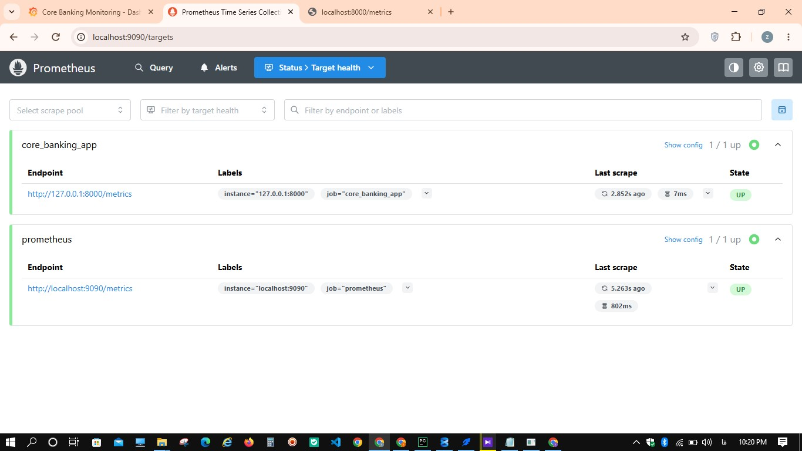](docs/images/prometheus-targets.jpg)

## 3. Grafana dashboard | داشبورد Grafana

1. Open Grafana at `http://localhost:3000`.
2. Add a Prometheus data source with the URL `http://localhost:9090`.
3. Create a dashboard named **Core Banking Monitoring** with two panels:

| Panel                     | PromQL query                                    |
|---------------------------|-------------------------------------------------|
| **Function Calls**        | `sum by (function) (app_function_calls_total)`  |
| **Function Execution Time** | `app_function_last_duration_seconds`          |

<div dir="rtl">

1. ‏Grafana را در `http://localhost:3000` باز کنید.
2. ‏یک Data source از نوع Prometheus با آدرس `http://localhost:9090` اضافه کنید.
3. ‏یک داشبورد با نام **Core Banking Monitoring** و دو پنل بالا بسازید.

</div>

The finished dashboard:

<div dir="rtl">

‏داشبورد نهایی:

</div>

[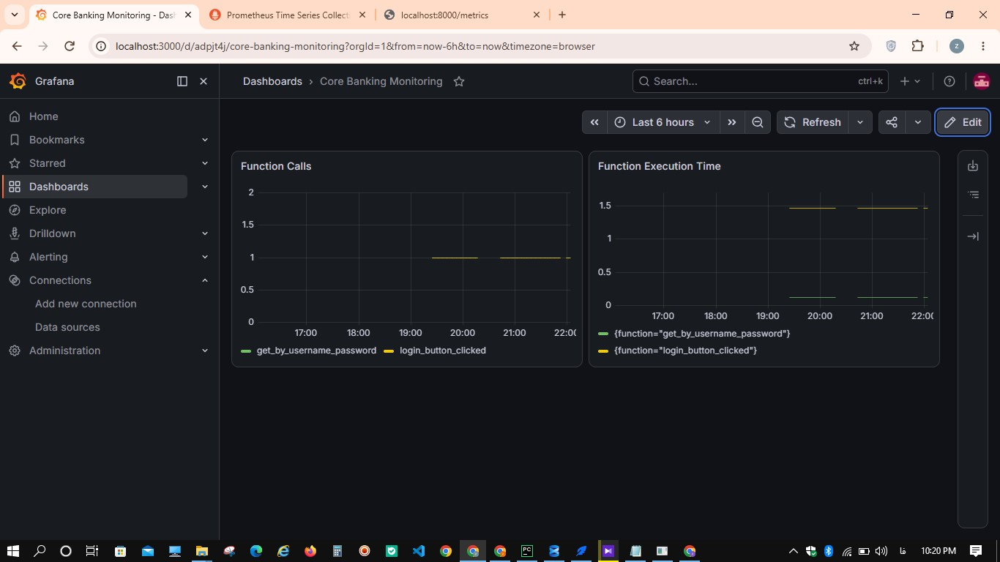](docs/images/grafana-dashboard.jpg)

---

# 🛠 Technologies Used | تکنولوژی‌های استفاده‌شده

- Python
- FastAPI, Uvicorn and Pydantic
- Swagger UI (OpenAPI)
- Tkinter and ttkbootstrap
- SQLAlchemy
- SQL Server (pyodbc, pymssql)
- RabbitMQ (pika)
- python-dotenv
- Captcha (Pillow)
- Prometheus (prometheus_client)
- Grafana
- unittest
- Layered Architecture
- Microservice Architecture

---

# 📂 Project Structure | ساختار پروژه

```
CoreBanking/
│
├── BusinessLogic/
│   ├── user_business_logic.py
│   ├── auth_business_logic.py
│   ├── otp_business_logic.py
│   └── account_business_logic.py
│
├── Common/
│   ├── Decorators/
│   │   └── performance_logger.py
│   ├── DTOs/
│   ├── Entities/
│   ├── Enums/
│   ├── Repositories/
│   └── Services/
│       ├── notification_publisher.py
│       └── sms_service.py
│
├── DataAccess/
│   ├── Config/
│   ├── Models/
│   └── Repositories/
│
├── Presentation/
│   ├── API/
│   │   ├── DI/
│   │   ├── DTOs/
│   │   └── Endpoints/
│   ├── Component/
│   ├── Frames/
│   ├── main_view.py
│   └── window.py
│
├── docs/
│   └── images/
├── tests/
│   ├── test_otp_business_logic.py
│   ├── test_auth_business_logic.py
│   └── test_account_business_logic.py
│
├── .env.example
├── .gitignore
├── CreateDatabase.sql
├── main.py
├── main_api.py
└── requirements.txt
```

| Layer / لایه    | Responsibility                                          | وظیفه                                                     |
|-----------------|---------------------------------------------------------|-----------------------------------------------------------|
| `Presentation`  | Tkinter windows and frames, and the FastAPI endpoints   | پنجره‌ها و صفحه‌های Tkinter و endpoint های FastAPI        |
| `BusinessLogic` | Login, OTP, account and validation rules                | قوانین ورود، OTP، حساب و اعتبارسنجی                       |
| `DataAccess`    | SQLAlchemy models and repositories                      | مدل‌ها و ریپازیتوری‌های SQLAlchemy                        |
| `Common`        | Entities, enums, DTOs, decorators, shared services      | موجودیت‌ها، Enum ها، DTO ها، دکوراتورها و سرویس‌های مشترک |

---

# 🔐 Roles | نقش‌ها

| Role          | Home page options                       | گزینه‌های صفحه‌ی اصلی             |
|---------------|-----------------------------------------|-----------------------------------|
| Administrator | Employee Management, My Profile, Logout | مدیریت کارمندان، پروفایل من، خروج |
| Banker        | Account Management, My Profile, Logout  | مدیریت حساب‌ها، پروفایل من، خروج  |
| Customer      | Mobile app: login with OTP, accounts, balance, transactions (through the API) | اپلیکیشن موبایل: ورود با OTP، حساب‌ها، موجودی، تراکنش‌ها (از طریق API) |

---

# ⚙️ Environment Variables | متغیرهای محیطی

Copy `.env.example` to `.env` and fill in the values. The `.env` file is ignored by Git and must never be uploaded.

<div dir="rtl">

‏فایل `.env.example` را به `.env` کپی کنید و مقدارها را پر کنید. فایل `.env` توسط Git نادیده گرفته می‌شود و هرگز نباید آپلود شود.

</div>

| Variable                | Description                                           | توضیح                                                      |
|-------------------------|-------------------------------------------------------|------------------------------------------------------------|
| `DB_SERVER`             | SQL Server address                                    | آدرس SQL Server                                            |
| `DB_NAME`               | Database name                                         | نام پایگاه داده                                            |
| `DB_USERNAME`           | Database username                                     | نام کاربری پایگاه داده                                     |
| `DB_PASSWORD`           | Database password                                     | رمز عبور پایگاه داده                                       |
| `DB_DRIVER`             | ODBC driver used by pyodbc, installed on your machine | نام ODBC Driver نصب‌شده روی سیستم که pyodbc استفاده می‌کند |
| `RABBITMQ_HOST`         | RabbitMQ server address                               | آدرس سرور RabbitMQ                                         |
| `RABBITMQ_PORT`         | RabbitMQ port (5672)                                  | پورت RabbitMQ (معمولاً 5672)                               |
| `RABBITMQ_USERNAME`     | RabbitMQ username                                     | نام کاربری RabbitMQ                                        |
| `RABBITMQ_PASSWORD`     | RabbitMQ password                                     | رمز عبور RabbitMQ                                          |
| `RABBITMQ_VIRTUAL_HOST` | RabbitMQ virtual host                                 | Virtual Host در RabbitMQ                                   |
| `SMSIR_API_KEY`         | sms.ir API key                                        | کلید API سایت sms.ir                                       |
| `SMSIR_LINE_NUMBER`     | sms.ir line number                                    | شماره‌ی خط sms.ir                                          |

---

# 🚀 How To Run | نحوه اجرا

Make sure SQL Server and RabbitMQ are installed and running, then clone the repository:

<div dir="rtl">

‏مطمئن شوید SQL Server و RabbitMQ نصب و روشن هستند، سپس پروژه را کلون کنید:

</div>

```
git clone https://github.com/zahrasalimzadeh/CoreBanking.git
```

Open the project folder:

```
cd CoreBanking
```

Install the requirements:

```
pip install -r requirements.txt
```

Create the database by running `CreateDatabase.sql` in SQL Server Management Studio. It creates the `CoreBanking0606` database with all tables and sample data.

<div dir="rtl">

‏پایگاه داده را با اجرای فایل `CreateDatabase.sql` در SQL Server Management Studio بسازید. این فایل پایگاه داده‌ی `CoreBanking0606` را با همه‌ی جدول‌ها و داده‌ی نمونه می‌سازد.

</div>

Create your `.env` file from the example and fill in the values:

```
copy .env.example .env
```

Start the [NotificationMicroservice](https://github.com/zahrasalimzadeh/NotificationMicroservice) (it must be running to deliver the SMS), then run what you need:

<div dir="rtl">

‏میکروسرویس [NotificationMicroservice](https://github.com/zahrasalimzadeh/NotificationMicroservice) را اجرا کنید (برای ارسال پیامک باید روشن باشد)، سپس هر بخشی که می‌خواهید را اجرا کنید:

</div>

| What / چی                    | Command / دستور                                 |
|------------------------------|-------------------------------------------------|
| Desktop application / دسکتاپ | `python main.py`                                |
| REST API / ای‌پی‌آی          | `uvicorn main_api:app --port 8001 --reload`     |
| Unit tests / تست‌ها          | `python -m unittest discover -s tests -t . -v`  |

Sample logins from `CreateDatabase.sql` (the password of all of them is `123456`):

<div dir="rtl">

‏ورودهای نمونه از فایل `CreateDatabase.sql` (رمز همه‌ی آن‌ها `123456` است):

</div>

| App / برنامه                  | Username or mobile / نام کاربری یا موبایل |
|-------------------------------|-------------------------------------------|
| Desktop (Banker) / دسکتاپ     | `z.salimzadeh`                            |
| Mobile app and API / موبایل و API | `09120000002`                         |

The sample mobile numbers are fake. To receive the real SMS, change the mobile number in the database to your own number.

<div dir="rtl">

‏شماره‌های موبایل نمونه ساختگی هستند. برای دریافت پیامک واقعی، شماره‌ی موبایل را در پایگاه داده با شماره‌ی خودتان عوض کنید.

</div>

To see the monitoring part, also start Prometheus (`prometheus.exe`) and Grafana, as described in the [Monitoring](#-monitoring--پایش-عملکرد) section.

<div dir="rtl">

‏برای دیدن بخش پایش، Prometheus (`prometheus.exe`) و Grafana را هم طبق بخش [پایش عملکرد](#-monitoring--پایش-عملکرد) اجرا کنید.

</div>

---

# 🎥 Demo | دمو

### 📸 Screenshots | تصاویر

**1. Login page with captcha | صفحه‌ی ورود با کپچا**

[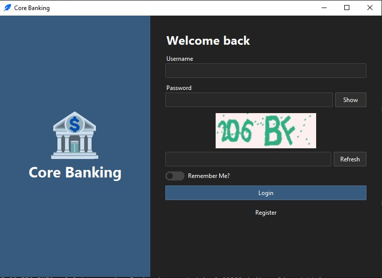](docs/images/desktop-login.jpg)

**2. Verification code page | صفحه‌ی وارد کردن کد تأیید**

[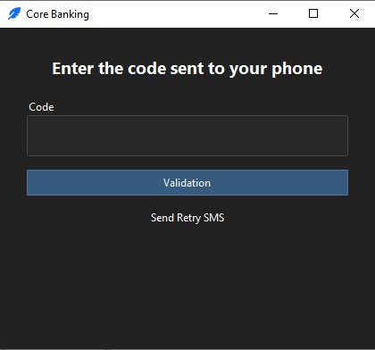](docs/images/desktop-otp.jpg)

**3. Registration page | صفحه‌ی ثبت‌نام**

[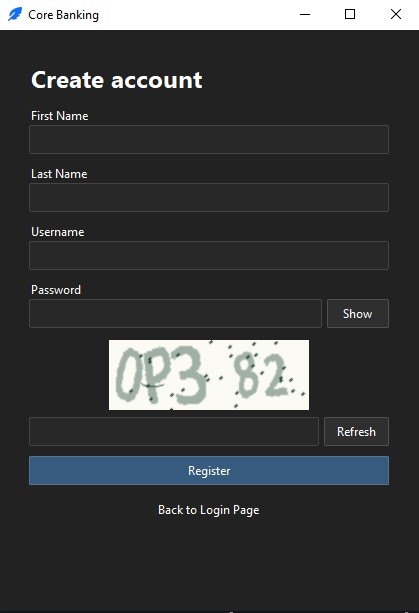](docs/images/desktop-register.jpg)

**4. Administrator home page | صفحه‌ی اصلی مدیر**

[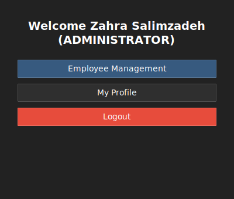](docs/images/desktop-home-admin.png)

**5. Banker home page | صفحه‌ی اصلی بانکدار**

[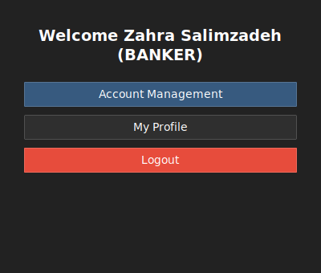](docs/images/desktop-home-banker.png)

The API screenshots are in the REST API section, and the monitoring screenshots are in the Monitoring section.

<div dir="rtl">

‏تصاویر API در بخش «واسط برنامه‌نویسی» و تصاویر پایش در بخش «پایش عملکرد» قرار دارد.

</div>

### 🎬 Videos | ویدیوها

The demo videos are published on LinkedIn:

<div dir="rtl">

‏ویدیوهای دمو در LinkedIn منتشر شده‌اند:

</div>

| Video                                       | ویدیو                            | Link                                                                                           |
|---------------------------------------------|----------------------------------|------------------------------------------------------------------------------------------------|
| Architecture diagram                        | نمودار معماری                    | [Watch on LinkedIn](https://www.linkedin.com/feed/update/urn:li:activity:7516609310831845376/) |
| Login and waiting for the verification code | ورود و منتظر ماندن برای کد تأیید | [Watch on LinkedIn](https://www.linkedin.com/feed/update/urn:li:activity:7516609963180367874/) |
| Receiving the code                          | دریافت کد                        | [Watch on LinkedIn](https://www.linkedin.com/feed/update/urn:li:activity:7516611332004061185/) |
| Home page after verification                | صفحه‌ی اصلی بعد از تأیید         | [Watch on LinkedIn](https://www.linkedin.com/feed/update/urn:li:activity:7516611776558301184/) |

---

# 📝 Notes | نکات

- The verification SMS is delivered by the NotificationMicroservice through sms.ir. An sms.ir account with enough credit is required to receive the real SMS.
- The queue and exchange names must be the same in CoreBanking and in the NotificationMicroservice.
- The metrics endpoint (port 8000) only exists while the desktop application is running. When it is closed, the `core_banking_app` target in Prometheus becomes DOWN. This is expected.
- The API runs on port 8001, so it can run at the same time as the desktop application.
- The balance and transactions endpoints do not check yet that the account belongs to the logged-in customer. Adding a token to protect them is planned.

<div dir="rtl">

- ‏پیامک تأیید توسط NotificationMicroservice و از طریق sms.ir ارسال می‌شود. برای دریافت پیامک واقعی، حساب sms.ir باید اعتبار کافی داشته باشد.
- ‏نام Exchange و Queue باید در CoreBanking و NotificationMicroservice یکسان باشد.
- ‏آدرس متریک‌ها (پورت 8000) فقط تا وقتی برنامه‌ی دسکتاپ روشن است وجود دارد. وقتی بسته شود، target با نام `core_banking_app` در Prometheus به حالت DOWN می‌رود. این رفتار طبیعی است.
- ‏API روی پورت 8001 اجرا می‌شود، پس هم‌زمان با برنامه‌ی دسکتاپ قابل اجرا است.
- ‏endpoint های موجودی و تراکنش‌ها هنوز بررسی نمی‌کنند که حساب متعلق به مشتریِ واردشده است. افزودن توکن برای محافظت از آن‌ها برنامه‌ریزی شده است.

</div>

---

# 👩‍💻 Developer | توسعه‌دهنده

**Zahra Salimzadeh**

- LinkedIn: [https://www.linkedin.com/in/zahra-salimzadeh-5767582ab/](https://www.linkedin.com/in/zahra-salimzadeh-5767582ab/)
- Email: zahrasalimzadeh7@gmail.com
